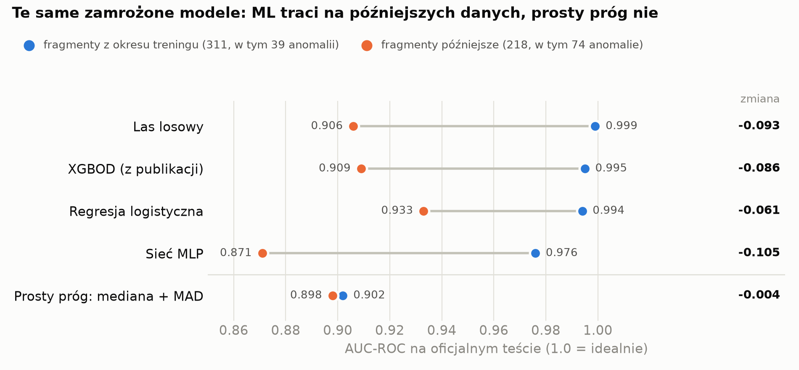

# SatDoctor: anomalie w telemetrii satelity ESA OPS-SAT

**Konsola na żywo: [satdoctor.streamlit.app](https://satdoctor.streamlit.app)** · dane: OPS-SAT-AD (ESA / KP Labs, [Zenodo 12588359](https://zenodo.org/records/12588359), CC BY 4.0)

Odtworzyłem opublikowany benchmark wykrywania anomalii w telemetrii satelity OPS-SAT i sprawdziłem,
ile jego wyniki są warte na danych z **późniejszej** części misji. Do tego konsola, w której operator
sam wybiera kompromis między wykrytymi anomaliami a fałszywymi alarmami.

## W skrócie

1. **Wyniki publikacji da się odtworzyć.** XGBOD na protokole autorów: F1 **0.913** (w publikacji 0.918), AUC-PR **0.978** (0.975).
2. **Losowy podział trening/test zawyża wyniki uczenia maszynowego.** Te same zamrożone modele są niemal
   idealne na fragmentach testowych z okresu treningu i wyraźnie słabsze na późniejszych.
   Prosty próg, który nie uczy się z przykładów, nie traci nic. To mocna wskazówka, nie dowód (szczegóły w *Ograniczeniach*).
3. **Mimo to ML naprawdę bije prosty próg, także na danych z przyszłości**: regresja logistyczna AUC-ROC 0.950 [0.920–0.975]
   wobec 0.905 [0.873–0.935] dla progu.
4. **Las losowy i XGBOD dały 0 fałszywych alarmów na 624 normalnych fragmentach testowych**, wykrywając 57–66% anomalii.
   Który detektor jest „najlepszy”, zależy od tego, ile fałszywych alarmów operator zniesie.



## Dane i problem

OPS-SAT to nanosatelita-laboratorium ESA. Zbiór OPS-SAT-AD zawiera **2123 krótkie fragmenty** telemetrii
z 9 kanałów (mediana 70 próbek, próbkowanie co 1 lub 5 s), oznaczone przez operatorów jako normalne lub anomalne.
Autorzy udostępnili podział trening/test (1594 / 529 fragmentów) i wyniki 30 modeli na 18 cechach fragmentu
(Ruszczak i in., *Scientific Data* 2025).

Przegląd danych pokazał, że ich podział jest **losowy w czasie**: 75–100% fragmentów testowych leży w środku
okresu treningowego tego samego kanału. Sąsiednie fragmenty jednego zdarzenia mogą więc trafić i do treningu,
i do testu. Stąd pytanie: ile model jest wart na danych, których okresu nigdy nie widział?

## Protokół

| Krok | Co zrobiłem |
|---|---|
| Podział czasowy | Oficjalny trening każdego kanału posortowany w czasie: pierwsze 60% → `fit` (uczenie), 20% → `val` (dobór progów), ostatnie 20% → `przyszłość` (własny test). Oficjalny test zostaje bez zmian. |
| Detektory | Prosty próg (mediana krocząca z sąsiadów + MAD), regresja logistyczna, las losowy, oraz z publikacji: XGBOD (PyOD, ustawienia domyślne) i sieć MLP jako **przybliżenie** ich FCNN, której architektury nie opublikowano. |
| Progi | Każdy detektor dostał próg maksymalizujący F0.5 na `val` (precyzja ważniejsza niż czułość, jak u operatora). |
| Zamrożenie | Modele, progi i podział zapisane z sumami sha256 **przed** otwarciem testu ([`wyniki/zamrozone.json`](wyniki/zamrozone.json), [`wyniki/zamrozone_dodatek.json`](wyniki/zamrozone_dodatek.json)). |
| Test | Uruchomiony **raz**. Skrypt sprawdza sumy i odmawia ponownego uruchomienia. |

Pułapki wyłapane po drodze:
- kolumna `label` w danych dla każdej anomalii brzmi po prostu `anomaly`, czyli zdradza etykietę; nie jest używana,
- znaczniki czasu mają rozdzielczość 1 s i bywają zdublowane, więc kolejność próbek musi być wszędzie liczona tak samo,
- kontrola skrótu: model uczony **tylko** na metadanych fragmentu (długość, czas trwania, przerwy) ma na walidacji F0.5 0.392,
  czyli tyle, co alarmowanie zawsze; sposób wycięcia fragmentów nie zdradza etykiety.

## Wyniki

Progi zamrożone na walidacji. FA/100 = fałszywe alarmy na 100 normalnych fragmentów. W nawiasach 95% przedział z bootstrapu.

**Oficjalny test** (529 fragmentów, 113 anomalii; modele uczone tylko na `fit`)

| Detektor | F1 | Precyzja | Czułość | FA/100 | AUC-ROC |
|---|---|---|---|---|---|
| Regresja logistyczna | **0.839** | 0.875 | 0.805 | 3.1 | **0.974** [0.960–0.986] |
| Las losowy | 0.778 | **1.000** | 0.637 | **0.0** | 0.971 [0.956–0.983] |
| XGBOD | 0.723 | **1.000** | 0.566 | **0.0** | 0.967 [0.945–0.984] |
| MLP | 0.785 | 0.854 | 0.726 | 3.4 | 0.918 [0.883–0.950] |
| Prosty próg | 0.604 | 0.486 | 0.796 | 22.8 | 0.874 [0.839–0.906] |

**Test „przyszłość”** (318 fragmentów, 110 anomalii; ostatnie 20% czasu każdego kanału)

| Detektor | F1 | Precyzja | Czułość | FA/100 | AUC-ROC |
|---|---|---|---|---|---|
| Regresja logistyczna | **0.877** | 0.912 | 0.845 | 4.3 | 0.950 [0.920–0.975] |
| Las losowy | 0.764 | **1.000** | 0.618 | **0.0** | **0.957** [0.931–0.980] |
| XGBOD | 0.792 | **1.000** | 0.655 | **0.0** | 0.935 [0.900–0.963] |
| MLP | 0.798 | 0.928 | 0.700 | 2.9 | 0.945 [0.914–0.969] |
| Prosty próg | 0.735 | 0.752 | 0.718 | 12.5 | 0.905 [0.873–0.935] |

**Odtworzenie publikacji** (cały oficjalny trening, domyślne progi, oficjalny test)

| Model | F1 u mnie | F1 w publikacji | AUC-PR u mnie | AUC-PR w publikacji |
|---|---|---|---|---|
| XGBOD | 0.913 | 0.918 | 0.978 | 0.975 |
| Regresja logistyczna | 0.845 | 0.800 | 0.939 | 0.931 |
| MLP (u nich FCNN) | 0.832 | 0.946 | 0.928 | 0.979 |

MLP to nie ich sieć, więc różnica przy FCNN niczego nie dowodzi. Pełne liczby: [`wyniki/wyniki_test.json`](wyniki/wyniki_test.json).

## Ograniczenia

- Podział oficjalnego testu na „okres treningu” i „później” nie ma przedziałów ufności, a w pierwszej części jest tylko 39 anomalii.
  Części różnią się też udziałem anomalii (13% vs 34%); AUC-ROC jest na to odporne, ale mogą się różnić typy anomalii.
  Stabilny wynik prostego progu przemawia przeciw wyjaśnieniu „późniejsze dane są po prostu trudniejsze”, ale go nie wyklucza.
- Modele uczone na `fit` widziały tylko 60% oficjalnego treningu, więc ich liczby nie są wprost porównywalne z publikacją.
- Na walidacji prosty próg wydawał się prawie tak dobry jak ML (F0.5 0.714 vs 0.780). Test tego nie potwierdził.
- Jednostką jest krótki fragment wybrany przez operatora, nie ciągły strumień. Wyników nie da się przełożyć na alarmy na dobę pracy misji.
- Jedna misja, 9 kanałów opisanych tylko kodem. Konsola pokazuje, kiedy sygnał przekroczył próg, ale nie diagnozuje fizycznej przyczyny.

## Konsola

[satdoctor.streamlit.app](https://satdoctor.streamlit.app) pokazuje **tylko fragmenty walidacyjne** (test nie był używany do strojenia):
- wybór detektora i suwak progu z metrykami liczonymi na żywo,
- wykres kompromisu: wykryte anomalie a fałszywe alarmy, dla wszystkich detektorów,
- przebieg sygnału z medianą, próbkami ponad progiem i momentem pierwszego alarmu,
- filtry przeoczeń i fałszywych alarmów oraz gra „Ty kontra model”.

Lokalnie: `pip install -r requirements.txt && streamlit run app.py`.

## Odtworzenie

```bash
pip install -r requirements.txt scikit-learn pyod xgboost matplotlib
python inspect_opssat.py ~/data/opssat     # pobranie z Zenodo (md5) + przegląd
python baseline_opssat.py ~/data/opssat    # podział czasowy, proste detektory
python ml_opssat.py ~/data/opssat          # modele ML i kontrola skrótu na walidacji
python zamroz_opssat.py ~/data/opssat      # zamrożenie + dane konsoli
python dodatek_opssat.py ~/data/opssat     # XGBOD i MLP, zamrożone przed testem
python test_opssat.py ~/data/opssat        # jednorazowy test
```

## Źródło danych

Ruszczak B., Kotowski K., Evans D., Nalepa J., *The OPS-SAT benchmark for detecting anomalies in satellite telemetry*,
Scientific Data (2025), DOI [10.1038/s41597-025-05035-3](https://doi.org/10.1038/s41597-025-05035-3).
Dane: [Zenodo 12588359](https://zenodo.org/records/12588359), licencja CC BY 4.0.
